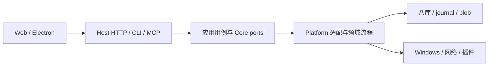

# 系统架构与业务所有权

NexusPipeline 在一个 Windows 实例内组织自动化定义、配置、执行、调度、记录与扩展。入口从 [Program.cs](../../apps/host/Program.cs) 分派到桌面启动、服务、CLI 或维护；[ApplicationHost](../../apps/host/Composition/ApplicationHost.cs) 组合实例租约、数据库、恢复、业务服务和控制面。

运行时调用由控制入口进入用例，再通过具体适配器完成效果；编译依赖以[解决方案](../../NexusPipeline.slnx)和各工程引用为准。

## 组件与代码

| 组件 | 路径 | 职责与边界 |
|---|---|---|
| Core | `src/core` | 领域规则、用例与 ports；不依赖 Host、Platform、wire DTO、SQLite 或 UI |
| Platform | `src/platform` | SQL、文件、Windows、网络、扩展适配；`Storage` 同时承载部分应用流程 |
| Host | `apps/host/Composition`、`Control`、`Lifecycle` | 组合根、HTTP/CLI/MCP、权限、服务与实例生命周期 |
| Web | `apps/web/src` | Vue 页面、typed control client、公共元素、草稿与资源 owner |
| Desktop | `apps/desktop`、`apps/host/Desktop` | Electron 窗口、托盘、受限原生桥和签名会话 |
| Launcher | `apps/launcher` | 兼容已登记 GUI 启动路径；新手动入口为根 Host WinExe |
| Maintenance / Installer / Uninstaller | `apps/maintenance`、`apps/installer`、`apps/uninstaller` | 应用切换、安装归属、恢复与数据选择 |
| SDK / contracts | `sdk/dotnet`、`sdk/frontend`、`contracts` | 公开能力与生成 wire 定义；插件独立消费 |
| 工具与测试 | `tooling`、`tests` | 冻结输入、依赖、构建、现役验证与受控夹具 |

## 从运行入口定位

| 入口或加载约定 | 首个源码位置 | 后续方向 |
|---|---|---|
| Host 命令、worker 与无参数桌面启动 | [Program.cs](../../apps/host/Program.cs) | `Composition/ApplicationHost.cs`；HTTP、CLI、MCP 进入 `Control` 的同一用例 |
| Web 页面与全局 Vue 控件 | [main.ts](../../apps/web/src/main.ts) | `app/App.vue` 组合页面，`app/store.ts` 解释路由与页面状态 |
| Electron 主进程与预加载桥 | [main.cjs](../../apps/desktop/main.cjs) | `preload.cjs`、原生会话及托盘生命周期 |
| managed 插件 | [InstalledExtensionRuntime.cs](../../src/platform/Extensions/InstalledExtensionRuntime.cs) | manifest 的 `managed.entryType` 经反射构造，能力通过 SDK 接口调用 |
| 插件浏览器模块 | [frontend-loader.ts](../../apps/web/src/extensions/frontend-loader.ts) | 按授权 URL 动态导入 `createFrontend`，生命周期由 registry 管理 |
| 原生控件与生成协议 | [register-elements.ts](../../apps/web/src/ui/register-elements.ts)、`contracts/schemas` | 自定义元素经浏览器回调；生成物按 `tooling/generated_sources.json` 的 producer 维护 |

测试按对应 owner 查 `tests/unit`、`tests/integration/storage`、`tests/windows` 和 `tests/frontend`；SDK 契约查 `tests/contracts`。共享源码也可能由多个 `.csproj` 链接，删除前须检查每个编译上下文、序列化格式和动态加载约定。

## 业务事实归属

| 事实 | owner | 实现入口 |
|---|---|---|
| 脚本、账号、绑定、队列定义 | Automation | `src/core/Automation`、`Storage/Automation` |
| 受理运行、调用额度、预算与结果 | Execution | `src/core/Execution`、`Storage/Execution` |
| 保存修订、活动输入与外部原现场 | Configuration | `src/core/Configuration`、`Storage/Configuration` |
| occurrence、分钟水位与等待 | Scheduling | `Storage/Scheduling` |
| 历史、日志和图片投影 | Records | `Storage/Records` |
| 安装、激活与 scope | Extensions | `Storage/Extensions`、`src/platform/Extensions` |
| 秘密、通知、设置与维护 | 对应领域 | `Storage/Secrets`、`Notifications`、`Settings`、`Maintenance` |

表中的 `Storage/` 位于 `src/platform/Storage`。更细的调用和 SQL/文件边界由[用例归属](storage-owners.md)维护。派生缓存和索引用于加速查询，业务权威仍归原 owner。

## 关键流程

- 执行：控制入口 → `ExecutionAdmissionService` 冻结输入与准入 → inbox → `AttemptRuntimeSession` → 实际 Job、配置采集/还原 → 原子终态与历史投影。详见[执行](../reference/execution.md)。
- 配置：初始来源或已保存修订 → 独立调用输入 → 验证活动输出 → 还原原现场 → 按策略长期发布。同次普通重试接续有效输出，见[配置](configuration.md)。
- 启动：实例与格式准入 → 当前恢复候选 → 服务、插件与调度就绪；完成历史按访问和完整诊断读取，见[启动](startup.md)。
- 插件：可信目录与原包 → 安装事务 → scope 激活 → 当前能力消费 → 撤销与排空，见[扩展](../reference/extensions.md)。

八库写入共用实例单写门和完整事务，配置、执行、通知仍由各自领域处理跨库关系。恢复先核验旧 writer 与物理对象，未知效果保全隔离；秘密通过专用能力处理。

## 已落实的依赖边界

`ConfigurationSessionFactory` 由 Host 的 `ExecutionRuntimeServices` 组合；`StepWriterScope` 提供真实停止事实。配置与执行交换类型化绑定、成员和现场证据，保留原事务和恢复 owner。具体边界由 [SourceBoundaries](../../tooling/boundaries/SourceBoundaries.cs) 检查；规则仅覆盖其声明范围。

公共 UI 接受窄能力和具名动作。SDK 不反向依赖 apps，插件通过公开 API 访问 Host。Web、CLI 和 MCP 共用业务用例及权限，原生能力另有[会话授权](../reference/desktop-authorization.md)。

## 插件业务边界

Host 消费注册的卡片贡献、manifest 元数据、静态图片和 emulator provider，不通过插件 ID 分配优先级或推导业务。概览布局持久化通用贡献键。前端准备协调器负责预算、取消和首次展示，不包含插件业务。

模拟器 provider 声明枚举参数、安装提示、配置扩展名、安装目录规则，以及选中实例的目录证据和启动/退出命令。Host 校验有界输入、根目录、工具物理身份、安装及授权代次，并将 provider 身份和命令封入执行证据；运行前再次要求相同 provider 解释当前源。旧选择缺少 provider 身份时仅接受唯一已发布 provider。MuMu 由宿主现役 Android 驱动实现。

预装范围由 Plugins 的构建声明决定；包回执传递 `bundledByDefault`，签名本地商店回执携带预装选择，产品装配据此复制已核验包。首次初始化从已核验的签名 catalog 与一次性选择清单安装，输入独立于应用文件归属，完成后清理；不维护固定插件名单。原生依赖准备由 Plugins 工具提供。

编译/AST 边界检查拒绝产品代码按固定 extensionId/providerId 分支。宿主测试保留通用授权、生命周期和显式消费真实插件包的集成场景。插件协议输出与厂商模拟行为位于 Plugins 的 `tests/host-fixtures`，由显式测试输入编译到所属 fixture；不进入 Host 产品。

| 内容 | 当前归属 | Host 消费方式 |
|---|---|---|
| 概览活动标题、说明、位置和布局键 | 活动插件前端贡献 | `SurfaceContribution.dashboard` 与通用贡献键校验 |
| 专项脚本图标、名称和说明 | 对应插件 manifest、资源和本地化元数据 | 授权静态图片接口、通用元数据列表 |
| 雷电、夜神、BlueStacks 的枚举、目录和命令 | emulator-support provider | SDK 描述与证据接口，Host 冻结权限及物理身份 |
| MuMu 驱动及其命令 | Host Android 能力 | 现役设备、媒体和执行端口 |
| Maa 原生输入、预装名单 | Plugins 构建声明与工具 | Host 装配消费正式包回执 |
| 专项协议输出与模拟器厂商 fixture | Plugins 测试源码 | `NexusPluginFixturesRoot` 显式编译输入及指纹 |

SDK 的模拟器 vendor 为插件声明的有界标识，Host 对选择使用小写标识和通用格式校验；厂商名称、稳定证据编码、安装发现、路径和命令规则由 provider 提供。标识在安装身份计算中保留原拼写，插件保持已保存目标 ID 的证据编码。旧配置未声明 provider 时，冻结证据单独保存唯一解析出的 owner，原配置字段保持不变。契约示例使用独立示例身份，宿主本地化资源不包含插件专属文案。
